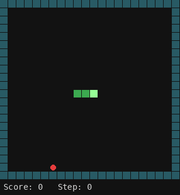

# snake-ai

Agents that play [snake-game](https://github.com/MiguelMochizuki/snake-game), trained with the neural network library [nn-cpp](https://github.com/MiguelMochizuki/nn-cpp).

## Contents

- [Overview](#overview)
- [Highlights](#highlights)
- [Quick Start](#quick-start)
- [Project Organization](#project-organization)
- [Tools & Stack](#tools--stack)
- [Usage](#usage)
- [Key Outputs & Reports](#key-outputs--reports)
- [Documentation Conventions](#documentation-conventions)
- [License](#license)

## Overview

The chosen approach is imitation: a small network learns to copy an expert player, and evolution strategies then fine-tune it past that teacher. The best network copies a safe A* player, one that only makes moves that keep the body on a Hamiltonian cycle of 2x2 tiles, so it can never trap itself. It scores 397 points (full board) in about 15,800 steps with no deaths in 12 games, and the same weights fill 10x10 and 40x40 boards without retraining. The fine-tuned network needs 11% fewer steps than that teacher on 20x20, still with no deaths.

## Highlights



The network playing a full 20x20 game (seed 1, one frame every 125 steps, 14,908 steps, 397 points), drawn by snake-game's own SDL renderer.

12 games on 20x20, same seeds, 397 = full board (details in [docs/REPORT.md](docs/REPORT.md)):

| Player | Points | Steps per game | Deaths |
|---|---|---|---|
| Hamiltonian cycle | 397 | 39,574 | 0/12 |
| Safe A\* (teacher) | 397 | 15,792 | 0/12 |
| Network imitating safe A\* | 397 | 15,792 | 0/12 |

The same network reaches the full board on 10x10 and 40x40 with exactly the teacher's step counts.

Going past the teacher, on 30 held-out games of 20x20 (paired seeds, bootstrap 95% interval; the gate asks for at least 3% fewer steps with the whole interval below zero; 0 deaths everywhere):

| Player | Steps per game | Change vs safe A\* |
|---|---|---|
| Safe A\* (teacher) | 16,016 | |
| Lookahead with the true future foods (upper bound only) | 10,291 | -35.7% |
| Honest lookahead (sampled futures) | 11,627 | -27.4% |
| Network fine-tuned with evolution strategies | 14,206 | -11.3% [-13.5%, -8.9%] |

The fine-tuned network keeps the gain on 40x40 (-10.0%, 4 games) and shows none on 10x10. Details and limits are in the report, section "Beating the safe A\*".

## Quick Start

Requirements: a C++17 compiler and CMake 3.16+.

```bash
git clone --recursive git@github.com:MiguelMochizuki/snake-ai.git
cd snake-ai
make test      # builds everything and runs the tests; binaries land in build/bin
make watch     # watch the ES fine-tuned network play in the terminal
```

## Project Organization

```
snake-ai/
├── .github/      # GitHub config
├── apps/         # executables: compare, evolve, imitate_astar, selector, watch
├── cmake/        # fetches doctest
├── deps/         # submodules: snake-game, nn-cpp
├── docs/         # REPORT.md and results/
├── experiments/  # one executable per study, logs in docs/results
├── include/      # snake_ai/{env,planning,teachers,policy,eval,gui}
├── models/       # trained checkpoints
├── src/          # implementations, mirroring include/snake_ai
├── tests/        # test suite
├── .gitignore
├── .gitmodules
├── CMakeLists.txt
├── CONTRIBUTING.md
├── LICENSE
├── Makefile
└── README.md
```

### Key modules

- Environment (`env/`): a headless environment over snake-game's `GameState`, with relative actions (straight, right, left), a runtime board size and two feature families.
- Planning (`planning/`): Hamiltonian cycles built from spanning trees of 2x2 tiles, a union-find test of whether the body still lies on some cycle, and three playing modes (A\*, shortcuts, cycle) that all preserve that property. Modes decide from a plain `Snapshot` of the game, with no random generator in it, so lookaheads built on `Sim` (a rollout simulator with its own generator) cannot see the real future foods.
- Teachers (`teachers/`): the cycle player with safe shortcuts, and the evolved heuristic used as a baseline.
- Policy (`policy/`): the network architecture, the policy that imitates the safe A\* player, and evolution strategies over the flat weights.
- Evaluation (`eval/`): paired games on fixed seed sets (validation, test), bootstrap confidence intervals and the 3% gate used to compare players.

## Tools & Stack

C++17, CMake, [nn-cpp](https://github.com/MiguelMochizuki/nn-cpp) (tensors, autograd, `Sequential`, Adam), [snake-game](https://github.com/MiguelMochizuki/snake-game) (game logic only, no terminal code) and [doctest](https://github.com/doctest/doctest) for the tests. CI runs on GitHub Actions.

Both dependencies are git submodules in `deps/`: `snake-game` at v2.3.3 (headers under `snake_game/`) and `nn-cpp` at v2.0.0.

## Usage

### Build

```bash
make test      # builds everything and runs the tests; binaries land in build/bin
make watch     # watch the ES fine-tuned network play in the terminal (CHECKPOINT=models/imitation_astar.ckpt KIND=astar for the imitation one)
make watch-gui # the same in a window (builds with SDL3 into build-sdl/)
```

`make help` lists everything: `make gui` and `make test-gui` build and test the variant with the window, `make gif` remakes the GIF above, and the submodules are fetched automatically. Each variant has its own build directory, so switching never forces a rebuild.

Without `make`: `cmake -S . -B build && cmake --build build -j` (add `-DSNAKE_AI_BUILD_GUI=ON` for the window). The options `SNAKE_AI_BUILD_APPS`, `SNAKE_AI_BUILD_EXPERIMENTS` and `SNAKE_AI_BUILD_TESTS` switch each part on or off. `-DSNAKE_AI_BUILD_GUI=ON` (default off) lets `watch` draw through snake-game's SDL3 renderer; it fetches SDL3 when configuring and needs the same system packages as snake-game's graphical version (see its README for the Linux list).

### Run

```bash
./build/bin/compare expert           # Hamiltonian cycle player
./build/bin/compare imitation        # trains the cycle-imitation network, writes imitation.ckpt, evaluates
./build/bin/compare dqn              # DQN with the cycle features
./build/bin/compare dqn-ego GENOME   # DQN with invariant features and shaping
./build/bin/compare ga GENOME        # evaluates the evolved heuristic
./build/bin/evolve GENOME [steps] [nocoil]   # genetic algorithm
./build/bin/imitate_astar            # trains the safe-A* imitation network, writes imitation_astar.ckpt
./build/bin/selector                 # learned mode selector
./build/bin/watch models/es_finetuned.ckpt 1 120 1 es   # watch the ES fine-tuned network play in the terminal
./build/bin/watch models/imitation_astar.ckpt 1 120 1 astar   # the imitation network
./build/bin/watch models/imitation_astar.ckpt 1 50 1 astar --gui   # same, in a window (GUI build)
./build/bin/watch models/imitation_astar.ckpt 1 50 125 astar --frames frames   # off-screen PPM frames, no display needed (GUI build)
./build/bin/safe_modes [games]       # A*, shortcut and cycle modes with the safety guarantee
./build/bin/scale_test               # 10x10, 20x20 and 40x40 boards with the 20x20-trained network
./build/bin/bfs_safe [games]         # shortest-path experiment
./build/bin/timed_astar <validate|test|smoke> [threads]                      # A* with a breadth-first search in time vs plain A*
./build/bin/lookahead_oracle <validate|test|smoke> [foods] [threads]         # lookahead that sees the true future foods (upper bound only)
./build/bin/lookahead_teacher <validate|test|smoke> [foods] [samples] [threads]   # honest lookahead on sampled futures
./build/bin/es_finetune [generations=200] [threads=12] [--sigma=X] [--lr=X] [--final]   # evolution strategies from models/imitation_astar.ckpt
./build/bin/es_finetune --eval [threads=12]   # reloads models/es_finetuned.ckpt and runs the final test
./build/bin/distill_lookahead [rounds=4] [games=48] [threads=12] [--final]   # distils the honest K=1 lookahead into the network (negative result, see the report)
```

Run from the repository root: the checkpoints are read and written by relative path.

### Configuration

`validate` uses seeds 20000 to 20019, `test` seeds 100000 to 100029 (20x20) and `smoke` two games on 10x10; the test games are for the final comparison only. `es_finetune` saves `models/es_trial.ckpt` and touches the test games only with `--final`, which is also the only run that writes `models/es_finetuned.ckpt`.

`GENOME` is the weights file written by `evolve`; `steps` is the per-game step cap during evolution (default 4000); `nocoil` zeroes the winding-number term for comparison. `watch` takes `checkpoint [seed] [ms per frame] [draw every N steps] [astar|es]` (`es` for `es_finetuned.ckpt`, whose 21 features differ from the imitation network's), plus `--gui` or `--frames DIR` in the GUI build. The GIF above was made from such frames: `ffmpeg -framerate 25 -i frames/frame-%05d.ppm -vf "crop=640:662:0:0,scale=360:-1:flags=lanczos,split[a][b];[a]palettegen=max_colors=24:stats_mode=diff[p];[b][p]paletteuse=dither=none" -loop 0 docs/astar_network.gif`. To see output while training, run under `stdbuf -oL`, since stdout is buffered when redirected.

### Tests

```bash
make test                                       # build and run all tests
ctest --test-dir build -R <name> --output-on-failure   # one test
```

## Key Outputs & Reports

- [docs/REPORT.md](docs/REPORT.md): results and design decisions.
- [docs/results/](docs/results/): raw logs of the final runs, one per experiment.
- `models/`: trained checkpoints (`imitation.ckpt`, `imitation_astar.ckpt`, `es_finetuned.ckpt`).
- [docs/astar_network.gif](docs/astar_network.gif): the network filling the 20x20 board.

## Documentation Conventions

See [CONTRIBUTING.md](CONTRIBUTING.md).

## License

MIT, see [LICENSE](LICENSE).
